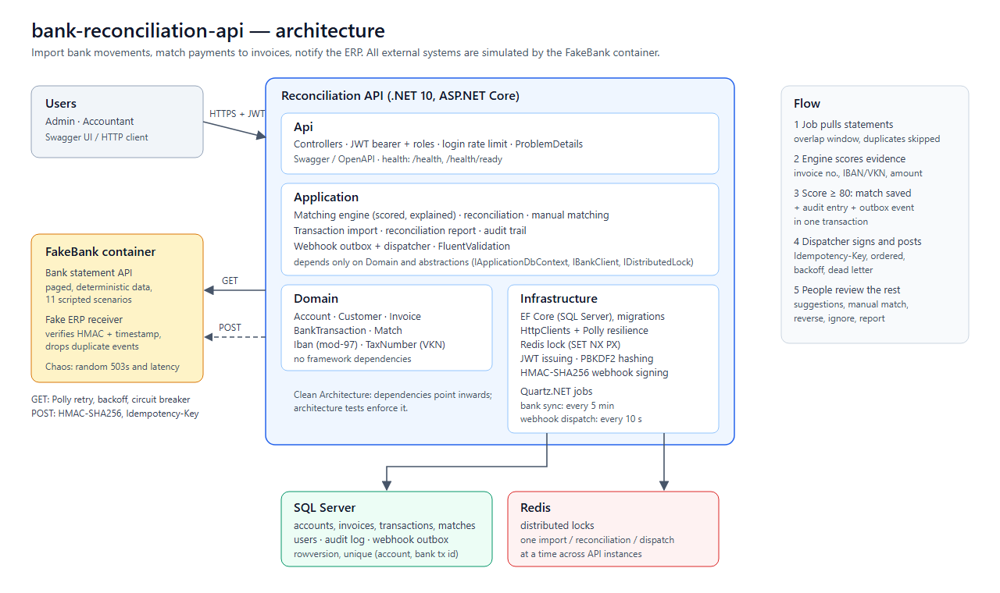
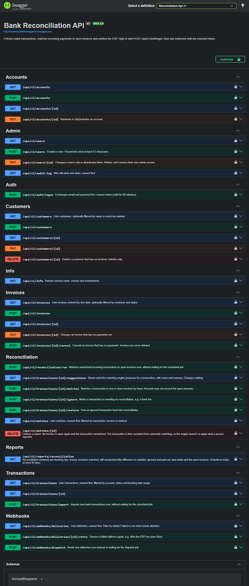

# bank-reconciliation-api

A .NET 10 Web API that imports a company's bank transactions, matches incoming payments to open invoices,
reports what is still unexplained and notifies the ERP through signed, idempotent webhooks.

Built as a portfolio project around the problems real payment integrations have: unreliable bank APIs,
duplicate data, ambiguous payment references, concurrent updates and at-least-once delivery.
All banks, companies, IBANs and tax numbers in it are fictional.



## What it does

1. **Imports** bank movements every 5 minutes from a bank statement API (simulated), page by page, without storing a movement twice.
2. **Matches** incoming payments to open invoices with a scoring engine that explains every decision:
   invoice numbers in free text, payer IBAN or tax number, amount, partial and over-payments, one payment for several invoices.
3. **Leaves the doubtful cases to people**: suggestions with scores, manual matching across invoices, reversal, ignore.
4. **Reports** per day what came in, what is matched and what difference is left to explain.
5. **Notifies the ERP** of every match and reversal with HMAC-signed webhooks from a transactional outbox.
6. **Secures and records** everything: JWT with Admin/Accountant roles, IBAN masking, an audit log written in the same transaction as each change.

## Tech stack

| Area | Choice |
|---|---|
| API | ASP.NET Core 10 Web API (controllers), ProblemDetails, Swagger / OpenAPI |
| Architecture | Clean Architecture: Domain, Application, Infrastructure, Api (enforced by architecture tests) |
| Data | EF Core 10 on SQL Server, migrations, rowversion concurrency, unique and check constraints |
| Caching / locking | Redis distributed locks (`SET NX PX`, compare-and-delete release) |
| Scheduling | Quartz.NET (bank sync every 5 min, webhook dispatch every 10 s) |
| Resilience | Polly via `Microsoft.Extensions.Http.Resilience`: retry with backoff and jitter, timeouts, circuit breaker |
| Security | JWT bearer, role-based authorization, PBKDF2 password hashing, login rate limiting |
| Validation | FluentValidation; IBAN (ISO 13616 mod-97) and Turkish tax number (VKN) value objects |
| Tests | xUnit, FluentAssertions, Testcontainers (SQL Server, Redis), WebApplicationFactory |
| DevOps | Docker Compose (api, mssql, redis, fake-bank), GitHub Actions (build, test, coverage, Docker images) |

## Quick start

Requires Docker.

```bash
cp .env.example .env   # set the database password, JWT key, demo user passwords and webhook secret
docker compose up --build
```

- Swagger UI: http://localhost:8080/swagger
- Health: http://localhost:8080/health (liveness), http://localhost:8080/health/ready (SQL Server and Redis)
- FakeBank: http://localhost:8081 (bank API and fake ERP receiver)

Compose applies migrations and seeds fictional demo data: 2 bank accounts, 4 customers, 8 invoices and two users.
The scheduled job imports and matches the bank movements right after startup.

### A five-minute tour in Swagger

1. `POST /api/v1/auth/login` with `accountant@example.com` and your `SEED_ACCOUNTANT_PASSWORD`, then **Authorize** with the `accessToken`.
2. `GET /api/v1/matches`: seven payments were matched automatically, each with a score and a reason.
3. `GET /api/v1/reports/reconciliation?from=<10 days ago>&to=<today>`: received vs matched vs still unexplained.
4. `GET /api/v1/transactions?status=Unmatched&incoming=true`, then `GET /api/v1/transactions/{id}/suggestions` for the 15,000.00 payment:
   the engine refuses to guess between two invoices of the same amount.
5. `POST /api/v1/transactions/{id}/matches` to match it by hand; sign in as `admin@example.com` and look at `GET /api/v1/audit-log`
   and `GET /api/v1/webhooks/deliveries`. The fake ERP's view: http://localhost:8081/erp/webhooks.



## How payments are matched

After each import the job runs the matching engine over unmatched incoming transactions.
It adds up evidence and applies proposals scoring **80 or more** (`Reconciliation__AutoMatchThreshold`);
the rest wait for a person.

| Signal | Points |
|---|---|
| Invoice number in description (any formatting: `inv2026-0008`, `INV/2026/0008`) | 70 |
| Only the digits of the invoice number (`Invoice 2026 0003`) | 60 |
| Payer identified by counterparty IBAN or by tax number (VKN) in description | 20 |
| Payer identified by company name only | 10 |
| Payer belongs to a different customer than the invoice | -40 |
| Amount equals open amount / is a partial payment | 10 / 5 |
| No reference, but exactly one open invoice of the payer has this amount | 50 |

- One payment naming several invoices is split across them, oldest due date first.
- An overpayment pays the invoice in full; the remainder stays unmatched on the transaction.
- Two open invoices with the same amount and no reference are never guessed.
- Turkish letters are folded to ASCII before comparing (banks write `GIDA`, the customer record says `Gıda`).
- References respect number boundaries: `INV-2026-0001` is not found inside `INV-2026-00012`.

Every match stores its reason, for example:

```json
{
  "invoiceNumber": "INV-2026-0003",
  "amount": 42000.00,
  "score": 90,
  "reason": "digits of invoice number INV-2026-0003 in description; payer identified by counterparty IBAN; amount equals open amount",
  "method": "Automatic"
}
```

The FakeBank's 11 scripted movements exercise each rule; the outcome is checked by a test:

| Movement | Result |
|---|---|
| Full payment, `Payment for INV-2026-0001` | matched, score 100 |
| `INV-2026-0002 partial payment`, later the remainder | matched in two parts, invoice paid |
| `Invoice 2026 0003 settlement` | matched by digits, score 90 |
| 3,500.00 for an invoice of 3,200.00 | invoice paid, 300.00 left unmatched |
| 15,000.00 `Transfer`, payer has two invoices of 15,000.00 | left for manual matching |
| `VKN 4567890128 payment`, unknown IBAN | matched by tax number and amount, score 80 |
| `inv2026-0008` | matched, score 90 |
| Unknown payer, no reference | unmatched |
| Rent and bank fee (outgoing) | never matched |

## Daily reconciliation report

`GET /api/v1/reports/reconciliation?from=&to=[&accountId=][&currency=TRY]` returns, per booking day and in total:
money received, matched, **unmatched (the difference still to explain, including overpaid remainders)**, ignored and
paid out, the match rate, and open / overdue invoices. Sums are computed by SQL Server in one `GROUP BY`; days without
movements are included so the report has no gaps. For the demo data after automatic matching:

```json
"totals": {
  "incomingCount": 9,
  "incomingAmount": 120335.05,
  "matchedAmount": 103800.49,
  "unmatchedCount": 3,
  "unmatchedAmount": 16534.56,
  "outgoingCount": 2,
  "outgoingAmount": 2512.50,
  "matchRatePercent": 86.3
}
```

## How transactions arrive

- **FakeBank** simulates a bank statement API (`GET /api/v1/accounts/{iban}/transactions?from=&page=`).
  Besides the scripted movements, every account gets random movements derived from (IBAN, time slot), so data is
  stable across restarts and new movements appear over time. It fails 20% of requests and adds up to 500 ms latency
  on purpose (`Chaos__*` settings).
- The import starts a few days before the newest stored booking date (banks book late), skips known movements and
  saves page by page. A unique index on (account, bank transaction id) is the final guarantee against duplicates.
- The bank client uses the Polly standard resilience pipeline: retries with exponential backoff and jitter,
  per-attempt timeout and a circuit breaker.
- Redis locks make sure only one import, reconciliation or webhook dispatch runs at a time across all API instances.
  `POST /api/v1/transactions/import` and `POST /api/v1/reconciliation/run` trigger them by hand.

## Manual matching

- `POST /api/v1/transactions/{id}/matches`: match a transaction to one or more invoices.
- `DELETE /api/v1/matches/{id}` with a reason: undo a match. The transaction is then excluded from automatic matching,
  so the engine doesn't re-apply a match a person rejected.
- `POST /api/v1/transactions/{id}/ignore` and `/restore`: take a transaction (e.g. a bank fee) out of reconciliation and back.

Manual changes and automatic reconciliation share one lock, so they never update the same invoice at the same moment;
invoices also carry a rowversion, so a concurrent change is detected rather than overwritten.

## ERP webhooks

There is no real ERP in this project: the FakeBank container also hosts a **fake ERP receiver** (`POST /erp/webhooks`,
inspect with `GET http://localhost:8081/erp/webhooks`) that implements the receiving side of the contract.
Point `Webhooks__Url` at any endpoint that does the same.

- **Transactional outbox:** the event row is saved in the same database transaction as the match, so an event is never
  lost and never sent for a change that was rolled back.
- **Signature:** `X-Webhook-Signature: sha256=hex(HMAC-SHA256(secret, "{timestamp}.{body}"))` with `X-Webhook-Timestamp`.
  The receiver checks it in constant time and rejects timestamps older than 5 minutes (replay protection).
- **Idempotency:** `Idempotency-Key` (= event id) lets the receiver ignore repeats. Delivery is at least once, so repeats
  happen; the fake ERP sometimes answers 503 after booking an event to show this.
- **Retries:** Polly retries quickly within a call (safe for POST because of the idempotency key); after that the outbox
  retries after 30 s, 1 min, 2 min ... up to 1 hour. 4xx responses (except 408/429) and events out of attempts become `Failed`.
- **Order:** a waiting event is never overtaken, so `match.created` always arrives before its `match.reversed`.
- **Admin:** `GET /api/v1/webhooks/deliveries?status=Failed`, `POST /api/v1/webhooks/deliveries/{id}/retry`.

## Security

- **Sign in:** `POST /api/v1/auth/login`; tokens are HMAC-SHA256 JWTs valid for 60 minutes. Only HS256 is accepted
  (a test checks that an unsigned `alg: none` token is rejected). The API refuses to start without a signing key of at least 32 characters.
- **Roles:** every endpoint requires a signed-in user unless it opts out. Accountants read everything, manage customers and
  invoices and match manually. Admins also manage bank accounts and users, delete customers, read the audit log and manage webhooks.
- **Passwords** are hashed with PBKDF2 (ASP.NET Core Identity hasher). Login is limited to 5 attempts per minute per IP
  and doesn't reveal whether an email exists.
- **IBAN masking:** non-admin users see `TR71******************0011`; audit entries always store masked IBANs.
- **Audit log:** logins, matches, reversals and changes to customers, invoices, accounts and users, written in the same
  database transaction as the change (`GET /api/v1/audit-log`).
- **Secrets** live in `.env` (git-ignored) or user secrets; nothing secret is in the repository.

## Build and test

```bash
dotnet build
dotnet test        # integration tests need Docker running
```

- **Unit tests** (no Docker): domain rules, matching engine edge cases, import, outbox dispatcher, signing, auth.
- **Integration tests** (Testcontainers): real SQL Server and Redis, the API and the FakeBank in one process. They run the
  whole flow (import, matching, report, signed webhooks to the fake ERP, manual matching) and check what an in-memory
  database can't: rowversion conflicts, unique indexes, the Redis lock, parallel imports.
- **Coverage:** about 85% of lines overall (migrations excluded), 96-100% for the matching engine, reconciliation and
  webhook dispatcher. `dotnet test --settings coverlet.runsettings --collect:"XPlat Code Coverage"`, merged with
  `dotnet reportgenerator`; CI publishes the merged summary on every run.

## Running the API outside Docker

Start the dependencies (`docker compose up -d mssql redis fake-bank`), then set user secrets for the API:

```bash
dotnet user-secrets --project src/Reconciliation.Api set "ConnectionStrings:Default" "Server=localhost,1433;Database=Reconciliation;User Id=sa;Password=<your password>;TrustServerCertificate=True"
dotnet user-secrets --project src/Reconciliation.Api set "Jwt:SigningKey" "<at least 32 characters>"
dotnet tool restore
dotnet ef database update -p src/Reconciliation.Infrastructure -s src/Reconciliation.Api
dotnet run --project src/Reconciliation.Api
```

Optional: `ConnectionStrings:Redis` (`localhost:6379`; without it an in-process lock is used),
`FakeBank:BaseUrl` (`http://localhost:8081`) with `Jobs:BankSync:Enabled=true`, and `Database:Seed=true` plus
`SeedUsers:*` passwords for demo data. Add a migration after changing the model:

```bash
dotnet ef migrations add <Name> -p src/Reconciliation.Infrastructure -s src/Reconciliation.Api -o Persistence/Migrations
```

## Design decisions and limits

- **Matching is explainable, not clever.** Fixed points per signal instead of a learned model, so every decision can be
  read, tested and argued about with an accountant. The engine never guesses between equal candidates.
- **Outbox instead of calling the ERP inline.** A database write and an HTTP call can't be atomic; the outbox makes the
  event part of the database transaction and moves the HTTP call to a retrying background job.
- **Single currency per report**, and open invoices in the report are as of now, not historical.
- **Not included:** refresh tokens, password change and account lockout, real bank or ERP connectors, multi-tenancy.
  Migrate-on-startup is meant for development and Compose; production would run migrations as a deployment step.

## License

MIT

---

## Türkçe özet

Bir işletmenin banka hesap hareketlerini otomatik çeken, gelen tahsilatları açık faturalarla eşleştiren, eşleşmeyenleri
raporlayan ve ERP'ye imzalı webhook ile bildiren .NET 10 Web API'si. Portföy projesidir; içindeki banka, şirket, IBAN ve
vergi numaraları hayalîdir.

- **Çekim:** Quartz.NET işi 5 dakikada bir banka API'sinden (FakeBank simülatörü) hareketleri sayfa sayfa çeker. Polly ile
  tekrar deneme ve devre kesici, Redis kilidiyle çakışmasız çalışma, unique index ile aynı hareketin iki kez kaydedilmemesi.
- **Eşleştirme:** Açıklamadaki fatura numarası, ödeyenin IBAN'ı veya VKN'si, tutar gibi kanıtlara puan veren motor; 80 ve
  üzeri otomatik eşleşir, her eşleşmenin gerekçesi saklanır. Kısmi ve fazla ödeme desteklenir; aynı tutarlı iki fatura
  arasında tahmin yapılmaz, karar kişiye bırakılır.
- **Manuel işlemler:** Öneri görme, elle eşleştirme, eşleşmeyi geri alma, hareketi yok sayma.
- **Rapor:** Günlük mutabakat özeti: gelen, eşleşen, açıklanması gereken fark, eşleşme oranı, açık ve vadesi geçmiş faturalar.
- **ERP bildirimi:** Transactional outbox, HMAC-SHA256 imza, Idempotency-Key, artan aralıklı tekrar deneme ve sıralı teslim.
- **Güvenlik:** JWT ve Admin/Accountant rolleri, PBKDF2 şifre hash'i, giriş hız sınırı, IBAN maskeleme, aynı transaction'da
  yazılan audit log.
- **Test:** xUnit unit testleri ve Testcontainers ile gerçek SQL Server ve Redis üzerinde uçtan uca entegrasyon testleri;
  GitHub Actions'ta derleme, test, kapsam raporu ve Docker imajı.

Çalıştırmak için: `.env.example` dosyasını `.env` olarak kopyalayıp değerleri doldurun, `docker compose up --build` çalıştırın
ve http://localhost:8080/swagger adresini açın.
